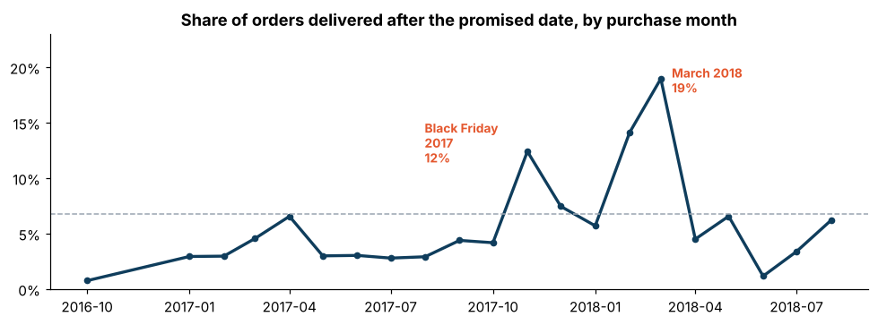
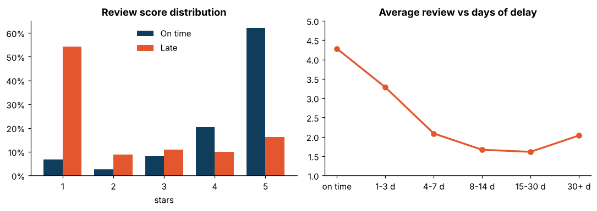
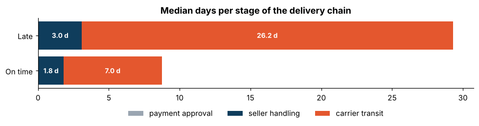
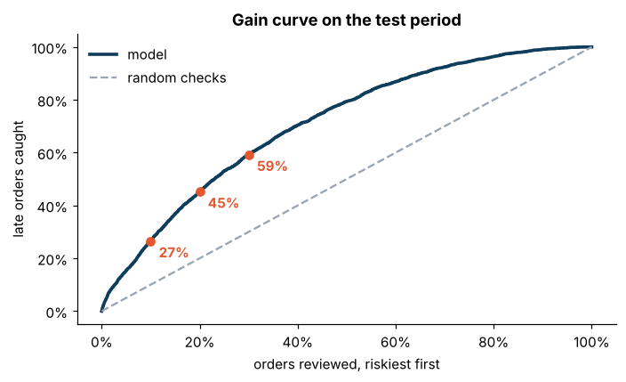

# Why do deliveries arrive late, and can we see it coming?


**[Interactive dashboard](https://mohfofana.github.io/projets/retards-livraison/)** ·
**[Full analysis notebook](notebooks/01_delivery_delays.ipynb)**

Analysis of **96,470 delivered orders** from the Olist marketplace (Brazil, 2016-2018).
Each customer sees a promised delivery date at checkout. This project measures how often that
promise is broken, what it costs in customer satisfaction, where the time is lost, and builds a
model that flags risky orders **at checkout**.

Data comes from the `fct_orders` table of my
[ecommerce-data-pipeline](https://github.com/mohfofana/ecommerce-data-pipeline) (dbt + DuckDB).

## Key findings

| | |
|---|---|
| **6.8 %** of orders arrive after the promised date | up to **19 %** in March 2018 and **12 %** around Black Friday 2017 |
| A late order gets **2.26 / 5** on average vs **4.28** on time | **63 %** of late orders get 1 or 2 stars |
| Customers tolerate **3 days** of delay (3.3 / 5) | from the 4th day, satisfaction falls below 2.1 / 5 |
| Late orders spend **26 days** in transport vs **7** | seller handling: 3.0 days vs 1.8 |
| A seller handing over after its deadline: **20.8 %** late vs 5.4 % | but this explains only 28 % of late orders |
| Same-state delivery: **4.5 %** late; beyond 2,000 km: **11.7 %** | the promised lead time barely adapts to distance |
| **Rio de Janeiro**: 12 % late | as bad as the North-East despite being next to São Paulo |





## Predicting late orders at checkout

**Constraint:** use only what is known when the customer pays. Handling and transit times are
measured afterwards and would leak the answer.

**Features** (`src/delay/features.py`): promised lead time, seller-customer distance, states,
basket size, weight, freight, payment, purchase date, and history features computed **only on
orders already delivered at that moment**:

- the seller's past late rate, smoothed toward the global rate so a seller with 2 orders does not get 0 % or 100 %;
- the route's recent real lead time (seller state to customer state);
- the **slack**: promised lead time minus that recent reality. This is the strongest signal.

A unit test (`tests/test_features.py`) checks that these history features never use orders that
were not yet delivered.

**Validation:** time-based split, trained on orders before March 2018 (57,317) and tested on the
following months (39,153). A random split would mix the same weeks and sellers between train
and test and overstate performance.

| Model | ROC-AUC | PR-AUC | Late orders caught in the riskiest 10 % |
|---|---|---|---|
| Logistic regression (baseline) | 0.66 | 0.11 | 18 % |
| **Gradient boosting** | **0.73** | **0.17** | **27 %** (x2.7 vs random) |



**Honest reading:** 0.73 is modest. Most of the delay happens in transport, after checkout, and
depends on events no order feature can see. The model is still actionable: reviewing the 10 %
riskiest orders catches 2.7 times more late orders than random checks, and the 30 % riskiest
catch 59 % of them.

## Recommendations

1. **Make the promise route-aware.** Set the promised date from each route's recent real lead time instead of a promise that barely moves with distance.
2. **Act before day 4.** Proactively inform and prioritize at-risk orders before the threshold where satisfaction collapses.
3. **Seller hand-over alerts.** A missed hand-over multiplies the late rate by 4. Alert sellers close to their deadline.
4. **Audit the last mile in Rio de Janeiro.**

## Project structure

```
├── src/delay/
│   ├── data.py         load fct_orders (local copy or pipeline export)
│   ├── features.py     leakage-free feature engineering
│   ├── model.py        time split, baseline, gradient boosting, business metrics
│   └── train.py        python -m delay.train  -> reports/metrics.json
├── notebooks/01_delivery_delays.ipynb    the full analysis, executed
├── dashboard/build_dashboard.py          builds the interactive dashboard (Plotly)
├── reports/                              figures and metrics
└── tests/                                pytest
```

## Run it

```bash
pip install -r requirements.txt
cd src && python -m delay.train && cd ..   # downloads fct_orders on first run
pytest
python dashboard/build_dashboard.py         # -> dashboard/index.html
jupyter notebook notebooks/01_delivery_delays.ipynb
```

## Limits

- Distances use state capitals (the public data only has zip prefixes).
- The test period (spring-summer 2018) is calmer than the training peaks: performance varies by season.
- No carrier information in the data, so transport delays cannot be attributed to a specific carrier.

Data: *Brazilian E-Commerce Public Dataset by Olist* (Kaggle, CC BY-NC-SA 4.0). Code: MIT.
